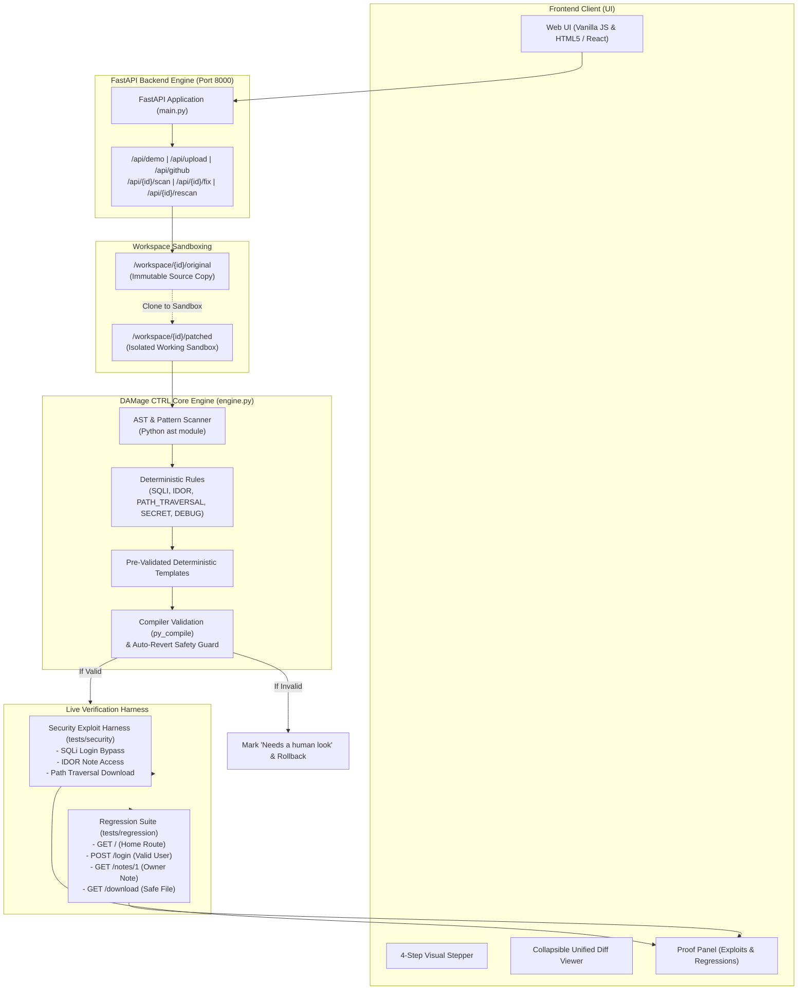

# DAMage CTRL

> **"Find the Flaw. Prove the Fix."**  
> An accessible, zero-jargon security tool built for solo developers, indie hackers, and small builders who know nothing about cybersecurity and cannot afford a professional security audit.

---

## 🛑 The Problem

Building web applications has never been easier—solo developers, bootstrappers, and non-technical founders are launching products with AI coding assistants and open-source boilerplates in days. 

However, **securing those applications remains broken**:
- **Prohibitive Cost**: Professional penetration tests and security consultants cost $10,000–$25,000+—completely out of reach for solo builders and bootstrapped startups.
- **Enterprise Jargon Overload**: Traditional AppSec tools (SAST/DAST) bombard non-technical founders with cryptic alerts, CVE codes, CVSS vectors, and overwhelming false positives that trigger panic without offering answers.
- **Hallucinated or Breaking Fixes**: Generic AI code generators often propose untested, hallucinated code that breaks existing application features or introduces subtle new vulnerabilities.
- **Lack of Proof**: No standard tool actually *proves* that a fix worked. Users are left wondering: *Did this patch really block the attacker, or did it just silence the scanner?*

DAMage CTRL changes the paradigm: it identifies security flaws, applies safe deterministic patches, and runs real exploits and regression tests to **prove** the fix worked—all explained in everyday language.

---

## ⚡ The 4-Step Solution

DAMage CTRL guides the user through an intuitive, 4-step progressive workflow:

```
[1. Pick your project] ──► [2. Check for problems] ──► [3. Fix them] ──► [4. Prove it's safe]
```

1. **Pick your project**:
   - **Try the Demo**: 1-click sandboxed vulnerable Flask notes app with pre-seeded vulnerabilities.
   - **Upload ZIP (50MB)**: Drag-and-drop your codebase archive (sanitized against Zip-Slip, 50MB limit).
   - **Public GitHub link**: Clone any public repository with an explicit ownership verification checkbox (*"I own this repository or have permission to test it"*).
   - **Live Website URL**: Real-time passive audit of any live website or web application URL for missing security headers (CSP, HSTS, X-Frame-Options), cookie flags, and server disclosures.
2. **Check for problems**:
   - **Deterministic AST & Pattern Scan**: Detects dangerous coding flaws without sending proprietary code to 3rd-party LLMs.
   - **Explain Like I'm 12 (ELI12)**: Every vulnerability is translated into relatable, everyday analogies alongside plain-English technical descriptions.
   - **Noise Filter (False-Positive Clearing)**: Safely cleared code patterns (such as integer-cast query parameters) are surfaced in green as "Cleared Safe Items," building developer confidence.
3. **Fix them**:
   - **Deterministic, Pre-Validated Templates**: Fixes are generated from rigorous, battle-tested security patterns—never free-form or unconstrained AI generations.
   - **Zero Risk to Original Source**: All fixes are executed exclusively on an isolated workspace copy (`/workspace/<id>/patched`). The original code remains 100% immutable.
   - **Clear Unified Diff**: View line-by-line before/after code changes with syntax highlighting.
4. **Prove it's safe**:
   - **Real Exploit Suite (Before vs. After)**: Runs automated, real-world attack payloads against the original app (verifying vulnerability) and against the patched copy (confirming the attack is 100% blocked).
   - **Functional Regression Suite**: Tests critical user journeys (login, data access, file downloads, home routes) to guarantee the patch broke nothing.
   - **Automated Re-scan**: Validates that the vulnerability count dropped to zero and provides a clean, downloadable patched ZIP.

---

## 🏗️ Architecture



---

## 🔍 Scope of Files Scanned

DAMage CTRL specifically targets and analyzes source code files while enforcing strict boundary constraints:

### Analyzed Target Files
- **File Extensions**: `.py` (Python 3.9–3.12+ source files).
- **Target Components**:
  - Web route handlers (e.g., Flask `@app.route`, URL endpoint handlers).
  - Database queries (raw SQL queries, cursor executions, f-string/concatenated statements).
  - File system operations (`open()`, `send_file()`, `send_from_directory()`, file downloads).
  - Application configuration (`app.secret_key`, `app.run(debug=True)`).

### Excluded Directories & Ignored Files
To prevent false alarms, infinite loops, and performance degradation, the scanner automatically ignores:
- Version control: `.git/`, `.svn/`, `.hg/`
- Virtual environments: `venv/`, `.venv/`, `env/`, `ENV/`
- Package managers: `node_modules/`, `site-packages/`
- Caches & build outputs: `__pycache__/`, `.pytest_cache/`, `dist/`, `build/`, `*.pyc`, `*.egg-info/`
- IDE & OS metadata: `.vscode/`, `.idea/`, `.DS_Store`, `Thumbs.db`
- Non-code binaries & media: `.jpg`, `.png`, `.gif`, `.pdf`, `.zip`, `.sqlite3`, `.db`

### Archive Upload Safety Limits
- **Max Archive Size**: 50 MB.
- **Max File Count**: 200 files per archive.
- **Zip-Slip Protection**: Rejects or strips filenames with relative paths (`../`) or absolute paths that would extract outside the target sandbox directory.

---

## ⏱️ 60-Second Stage Demo Script

*A high-impact speaker script designed for live stage presentations and hackathon pitches.*

| Time | Action on Screen | Speaker Script |
|---|---|---|
| **00:00 - 00:10** | Open DAMage CTRL at `http://127.0.0.1:8000` | *"Solo developers and non-technical founders launch incredible apps every day—but hiring a security team costs $15,000, and standard security scanners only dump cryptic alerts that nobody understands. We built DAMage CTRL: Find the Flaw. Prove the Fix."* |
| **00:10 - 00:20** | Click **"Run Full Demo"** (or click **"Try the Demo"** &rarr; **"Scan my project"**) | *"With one click, DAMage CTRL scans our demo notes app. Notice the language: no CVE numbers. We found 5 critical vulnerabilities and safely cleared 1 false alarm. Each issue comes with an everyday analogy any 12-year-old can understand."* |
| **00:20 - 00:35** | Step 3: Review the Fix & Unified Diff | *"Next, we click 'Fix everything for me'. Notice what we don't do: we never hallucinate code with unconstrained AI. We apply deterministic, pre-validated security templates directly to an isolated copy of the app—never touching the original."* |
| **00:35 - 00:50** | Step 4: Inspect the **Proof Panel** | *"Here is the breakthrough: Proof. We don't just hope it worked. DAMage CTRL runs real attacks against the original app—SQL injection, IDOR, and directory traversal all succeeded. Then, it ran the exact same attacks against the patched app—every single exploit was blocked. And our functional regression tests show 4 out of 4 passed. Legitimate users can still log in and read their notes."* |
| **00:50 - 01:00** | Click **"Download Patched Project"** | *"Zero vulnerabilities remaining. The developer downloads a clean, verified codebase in under 60 seconds. DAMage CTRL: Security for the rest of us."* |

---

## 🛡️ Limitations & Safety

DAMage CTRL was engineered with defensive safety as its foundational principle:

### 1. Sandboxed Processing
All patching and testing occurs inside dedicated, temporary workspaces (`/workspace/<id>/...`). The original uploaded code or repository is saved in `original/` as an immutable read-only baseline. 

### 2. Only Authorized Targets
DAMage CTRL is designed for source code you own or have explicit authorization to inspect. The public GitHub link and URL inputs mandate an active consent confirmation checkbox before execution is permitted. The tool never executes remote denial-of-service or external network penetration testing.

### 3. Deterministic Patches (No Hallucinations)
Security patches are derived from strictly formulated, deterministic code templates (e.g., standard parameterized queries with DB-API tuple parameters, `safe_path_join` canonical path verification, ownership checks). Free-form AI code generation is prohibited in the patch pipeline to eliminate unexpected regressions and secondary vulnerabilities.

### 4. Auto-Revert & "Needs a Human Look"
Before any patch is accepted:
1. The modified file is compiled with Python's `py_compile` module.
2. If syntax errors or AST structural deformities are detected, **the file is automatically rolled back to its original state**.
3. If a vulnerability cannot be repaired safely with 100% confidence, DAMage CTRL **never silently skips it or falsely marks it as fixed**. Instead, it flags the issue with a distinct warning badge: **"Needs a human look"** alongside step-by-step developer remediation guidance.

### 5. Current Language Support
Currently supports **Python 3.9+** and web applications built with **Flask**.

#### Built-in Rules:
1. `SQLI`: Detects unparameterized SQL queries via f-strings or `.format()`. Fixes with parameterized queries (`?` or `%s`).
2. `IDOR`: Detects direct database record access without user ownership checks. Fixes by injecting `user_id = session['user_id']` checks.
3. `PATH_TRAVERSAL`: Detects unvalidated file access via user input. Fixes with `safe_path_join` boundary validation using `os.path.commonpath`.
4. `HARDCODED_SECRET`: Detects inline Flask `secret_key` definitions. Fixes with `os.environ.get("SECRET_KEY", secrets.token_hex(32))`.
5. `DEBUG_MODE`: Detects production `debug=True` flags. Fixes with `debug=os.environ.get("FLASK_DEBUG", "False").lower() == "true"`.

---

### 🛠️ Developer Guide: Adding a New Rule

Adding a new deterministic security rule to DAMage CTRL requires three steps:

#### Step 1: Define the Rule in `engine.py`
Add your rule identifier, metadata, ELI12 explanation, and guidance to the `RULES` dictionary:

```python
RULES["NEW_RULE_ID"] = {
    "title": "Clear Technical Title",
    "plain_english": "What this problem is in plain words.",
    "eli12": "An everyday story analogy (e.g. leaving the front door unlocked).",
    "severity": "high",  # "critical" | "high" | "medium" | "low"
    "guidance": "Clear step-by-step instructions for manual remediation."
}
```

#### Step 2: Implement the AST Detector in `scan_project()`
Add a visitor check inside `scan_project()` in [`engine.py`](file:///c:/Users/Disha%20M%20K/OneDrive/Documents/code24/engine.py):

```python
# Example: Detect dangerous eval() usage
for node in ast.walk(tree):
    if isinstance(node, ast.Call) and isinstance(node.func, ast.Name) and node.func.id == "eval":
        findings.append({
            "id": f"finding_{uuid.uuid4().hex[:8]}",
            "rule_id": "NO_EVAL",
            "file": rel_path,
            "line": node.lineno,
            "code": lines[node.lineno - 1].strip(),
            "status": "needs_human_look",
            "guidance": "Replace eval() with json.loads() or ast.literal_eval()."
        })
```

#### Step 3: Implement Deterministic Fix & Test Cases
1. In `fix_project()`, add the corresponding regex or AST substitution template.
2. In [`tests/security.py`](file:///c:/Users/Disha%20M%20K/OneDrive/Documents/code24/tests/security.py), add an automated exploit that verifies the flaw is exploitable on the original and blocked on the patched app.
3. In [`tests/regression.py`](file:///c:/Users/Disha%20M%20K/OneDrive/Documents/code24/tests/regression.py), ensure standard app functionality remains 100% operational.

---

## 🎯 5-Slide Pitch Outline

### Slide 1: The Problem
- **Headline**: The Solo Builder Security Crisis.
- **Points**:
  - Millions of solo devs, indie hackers, and non-technical creators are building apps with AI and boilerplates.
  - Professional penetration testing costs $15,000+; existing enterprise tools only dump incomprehensible jargon and false alarms.
  - The result: Vulnerable apps, compromised user data, and ruined builder reputations.

### Slide 2: Who It's For
- **Headline**: Security Built for the 99% of Creators.
- **Points**:
  - **Solo Developers & Indie Hackers**: Ship fast without fearing basic security vulnerabilities.
  - **AI / "Vibe" Coders**: Validate that AI-generated boilerplate code doesn't contain glaring security holes.
  - **Non-Technical Founders**: Understand risk in plain English (ELI12) without needing a computer science degree.

### Slide 3: Live Demo (Find the Flaw. Prove the Fix.)
- **Headline**: From Vulnerable to Verified in 45 Seconds.
- **Visuals / Actions**:
  - 1-Click Scan: 5 vulnerabilities found + 1 false positive cleared.
  - Deterministic Fix: Safe template diff generated on an isolated copy.
  - The Proof: Live exploit suite passes from *Exploited* to *Blocked*; 4/4 regression tests pass.

### Slide 4: Why You Can Trust the Fix
- **Headline**: Real Proof, Zero AI Hallucinations.
- **Points**:
  - **Deterministic Patches**: Pre-tested code patterns, never unconstrained generative AI.
  - **Compiler Safety Guard**: Automated `py_compile` checks with auto-revert.
  - **True Exploit Verification**: Real HTTP exploit payloads prove the attack vector is neutralized.
  - **Full Transparency**: Any ambiguous flaw is surfaced as "Needs a human look"—never hidden.

### Slide 5: What's Next
- **Headline**: The Future of Accessible AppSec.
- **Roadmap**:
  - **Framework Expansion**: Django, FastAPI, Express.js / Node.js.
  - **CI/CD Automation**: GitHub Action gatekeeper that tests every Pull Request.
  - **Community Verified Template Library**: Open-source, crowd-verified deterministic security patches for popular frameworks.

---

## 💻 Quickstart & Verification Commands

### Run Full Test Suite
```bash
# On Windows
.\make.bat test

# On Linux / macOS
make test
```

### Run 1-Click Automated Stage Demo
```bash
# On Windows
.\make.bat demo

# On Linux / macOS
make demo
```

### Start Local Web Server
```bash
python -m uvicorn main:app --host 127.0.0.1 --port 8000
```
Open **`http://127.0.0.1:8000`** in your browser to access the full UI experience.

# code24a
